  
  
  

  
  

## 👋 About me

Full-stack developer who builds **production SaaS platforms end-to-end**: database design, secure APIs, polished frontends, and Linux VPS deployments. I ship multi-tenant, role-based platforms across **healthcare, automotive and education**, including an AI-powered EdTech product that's live today.

  

### ⚡ What I build

  

## 💼 Experience

### Full-Stack Developer
`2026 – Present` · Full-time · Production SaaS

- Delivered production platforms for automotive and healthcare operations on role-based architectures
- Designed secure APIs, approval workflows and multi-actor business logic across customer and provider roles
- Improved platform reliability through modular backend design, data-integrity rules and scalable workflows
- Shipped two flagship products end-to-end: **Saree3 (T-CARS)** and **Shifa Medical** ([see below](#-featured-projects))

### Full-Stack Developer · Optomatica (Azimut Project)
`2025 – 2026` · Cairo / Remote

- Built enterprise modules with **Spring Boot** and **React**
- Implemented API endpoints, authentication flows and data-visualization features
- Worked with product and engineering teammates to improve UX and system integration

### Full-Stack Developer & DevOps Engineer · Freelance
`2025` · Remote

- Architected and deployed production web apps for clients, from requirements to ongoing maintenance
- Built CI/CD pipelines with GitHub Actions / GitLab CI and containerized apps with Docker
- Managed cloud and VPS infrastructure (AWS, GCP, DigitalOcean), tuning resources to reduce hosting costs

## 🚀 Featured projects

<table>
<tr>
<td width="50%" valign="top">

### 📚 Hader · حَضّر
**AI lesson preparation & exam platform**

  

Production SaaS that helps teachers on Saudi Arabia's **Madrasati** platform auto-prepare lessons and generate AI-powered exams, with subscriptions and usage quotas, a full admin console and a support-ticket system.

</td>
<td width="50%" valign="top">

### 🏫 Nasaq · نسق
**Multi-tenant school management SaaS**

  

Upgraded a school platform into multi-tenant SaaS: tenant- and year-scoped data, a five-level role hierarchy, 30+ modules (academics, attendance, scheduling, online exams, digital library) and a full financial suite. Runs on a Hostinger VPS via Coolify.

</td>
</tr>
<tr>
<td width="50%" valign="top">

### 🚗 Saree3 · T-CARS
**Automotive multi-service platform**

   

One platform for car sales, rentals, maintenance services and licence-plate auctions, with role-based access and moderation flows for every actor.

</td>
<td width="50%" valign="top">

### 🏥 Shifa Medical · شفاء
**Multi-tenant healthcare RBAC platform**

  

Connects facility operations, doctor workflows and controlled prescription management, with admin approval flows, secure prescription issuance and structured medicine and dosage controls.

</td>
</tr>
<tr>
<td width="50%" valign="top">

### 🧮 Soroban Al-Barq
**Mental-math (abacus) learning platform** · Freelance

  

REST API powering course management, structured student-progress tracking and secure access control for an abacus learning platform.

</td>
<td width="50%" valign="top">

### 🩺 NurseConnect
**At-home nursing marketplace** · ITI graduation project

   

Connects verified nurses with patients for at-home care: location-based matching, secure booking, verified profiles and commission-based payments.

</td>
</tr>
</table>

<b>📂 More projects</b>

 

| Project | Stack | What it does |
|---|---|---|
| [Laravel Job Board](https://github.com/HamdySalah/Laravel-Job-Board) | Laravel · MySQL · Tailwind | Multi-role job portal (admin / employer / candidate) with approval workflows and resume uploads |
| [E-commerce API](https://github.com/HamdySalah/E-commerce-API-Node-Peoject) | Node.js · Express · MongoDB | Backend API for carts, orders, payments and multi-role users |
| [Exam System](https://github.com/HamdySalah/exam-system-full-stack) | Angular · Node.js · MongoDB | Exam platform with RBAC, question management and results |
| [Bash Script DBMS](https://github.com/HamdySalah/Bash-Script-Project) | Bash | CLI database engine for creating, storing and querying records on disk |
| [Sign Language Translator](https://github.com/HamdySalah/Sign-Language-Translator) | Python · OpenCV | Detects hand landmarks and translates gestures into readable text |
| [Weather Reporting System](https://github.com/HamdySalah/Weather-Reporting-System) | JavaScript · Firebase | Graduation project: campus meteorological reporting for faster decisions |
| [NYC Taxi Trip Analysis](https://github.com/HamdySalah/Big-Data-ML-Project-NYC-Taxi-Trip-Analysis-with-Apache-Spark) | Python · Apache Spark | Big-data and ML analysis of NYC taxi trips |

## 🛠️ Tech stack

<table>
<tr>
<td align="center" width="130"><b>Languages</b></td>
<td></td>
</tr>
<tr>
<td align="center"><b>Backend</b></td>
<td></td>
</tr>
<tr>
<td align="center"><b>Frontend</b></td>
<td></td>
</tr>
<tr>
<td align="center"><b>Databases</b></td>
<td></td>
</tr>
<tr>
<td align="center"><b>DevOps & Cloud</b></td>
<td></td>
</tr>
<tr>
<td align="center"><b>Tools</b></td>
<td></td>
</tr>
</table>

## 📊 GitHub activity

<picture>
  <source media="(prefers-color-scheme: dark)" srcset="https://streak-stats.demolab.com/?user=HamdySalah&border_radius=10&background=0D1117&border=30363D&stroke=30363D&ring=3B82F6&fire=8B5CF6&currStreakNum=C9D1D9&sideNums=C9D1D9&currStreakLabel=3B82F6&sideLabels=8B949E&dates=8B949E"/>
  
</picture>
<picture>
  <source media="(prefers-color-scheme: dark)" srcset="https://github-readme-stats.vercel.app/api/top-langs/?username=HamdySalah&layout=compact&langs_count=8&hide=html,css&card_width=360&border_radius=10&bg_color=0D1117&border_color=30363D&title_color=3B82F6&text_color=C9D1D9"/>
  
</picture>

  

<picture>
  <source media="(prefers-color-scheme: dark)" srcset="https://raw.githubusercontent.com/HamdySalah/HamdySalah/output/github-snake-dark.svg"/>
  
</picture>

## 🎓 Education

- **9-Month Professional Diploma, Open-Source Track:** Information Technology Institute (ITI), Assiut · `2024 – 2025`
- **BSc in Computer & Information Technology:** Assiut University · `2020 – 2024`

🌍 **Languages:** Arabic (native) · English (C1, advanced)

## 🤝 Let's work together

I'm open to **full-time roles, freelance projects and collaborations**, especially on SaaS and backend-heavy products.

